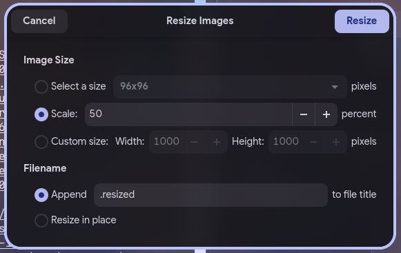
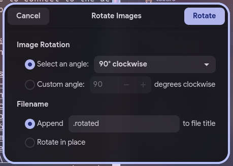
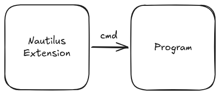

# Nautilus Image Converter Reborn (App)

Application part of Nautilus Image Converter Reborn, which can help you convert, resize, and rotate images.

## Features
* **Standalone app:** It now becomes a standalone app, not binding to Nautilus File Manager anymore. However, you can still bind parent window via CLI arguments.
* **Entirely in Rust:** No non-rust dependencies, which keeps this app performant, low memory footprint and stable.
* **Parallelism:** Instead of processing images one by one, this app process images in parallel by rayon.
* **Launch from CLI:** As it becomes a standalone app, you can launch it form other places through CLI interface directly.

## Screenshots
|Resize Image|Rotate Image|
|-----|-----|
|||

## Limitation
* **Unsupported formats:** This app only supports formats supported by the image crate; formats such as HEIC are currently not supported.

## Installation
### Ubuntu (or other Debian-based distro)
Download package from [release page](https://github.com/Kayxue/nautilus-image-converter-reborn-app/releases), and install it by double clicking on it or through command below:
```bash
sudo apt install <path-to-deb-package>
```

### Fedora (or other RedHat-based distro)
Download package from [release page](https://github.com/Kayxue/nautilus-image-converter-reborn-app/releases), and install it through command below:
```bash
sudo dnf install <path-to-rpm-package>
```

### Arch Linux (or other ArchLinux-based distro)
First, clone the repository through Git CLI.
```bash
git clone https://github.com/Kayxue/nautilus-image-converter-reborn-app-arch.git
```
Second, open terminal, `cd` into the folder and run command below:
```bash
makepkg -si
```

## Architecture



## Repository

* Extensions repository: [Here](https://github.com/Kayxue/nautilus-image-converter-reborn-extension)
* App repository: This repository

## Technology Stack (App part)

- Rust
- gtk-rs
- Relm4
- fast_image_resize
- image
- imageproc

## TODO
- [X] Arguments receiving logic.
- [X] Read image
- [X] Save image
- [X] Basic Image resizing using fast_image_resize
- [X] Basic image rotation (rotate image for 90, 180, 270 degrees) using image
- [X] Advanced image rotation (rotate image for arbitrary angle) using imageproc
- [X] Top window detection
- [X] GUI
- [ ] Image conversion
- [ ] Better error handling
- [ ] (if possible) Rewrite extension part using Rust.
- [ ] (if possible) Merge nautilus-extension part into this repo.

## AI Contribution Policy
Similar to [gtk-rs](https://github.com/gtk-rs/gtk4-rs#ai-contribution-policy)

## Contribution
Welcome to contribute to this project. Feel free to open an issue or submit a pull request. But:
1. Please follow [Code of Conduct](https://rust-lang.org/policies/code-of-conduct/)
2. Please format files and confirm your code before pushing to GitHub
3. If possible, please keep this app entirely in Rust and no non-rust dependencies such as libvip or Image Magick.
